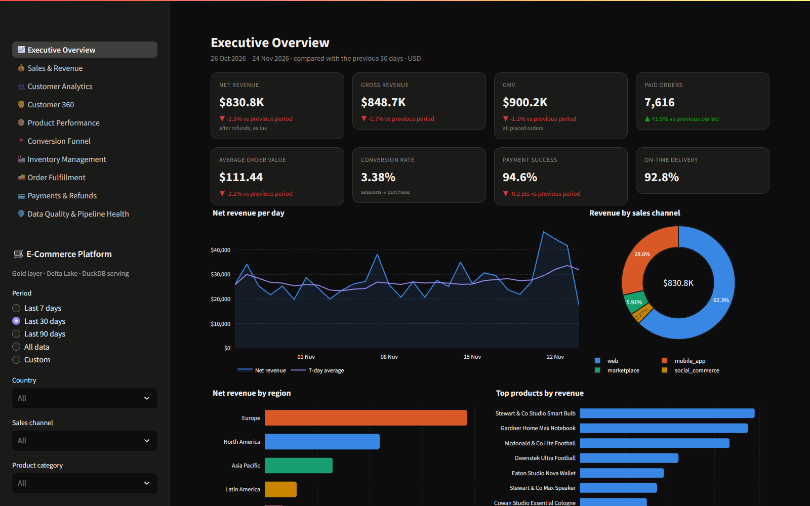
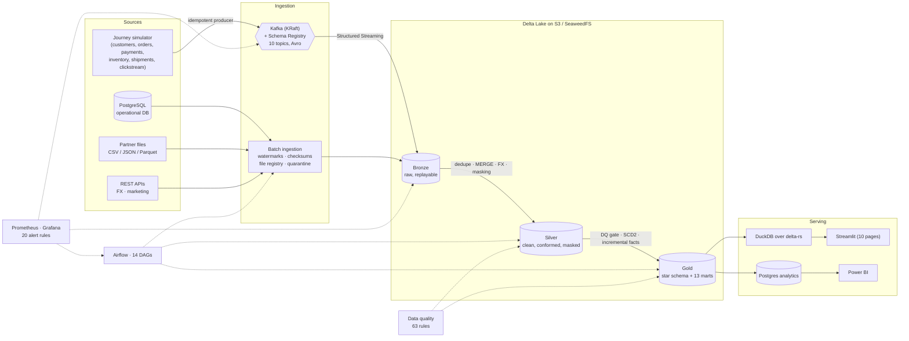
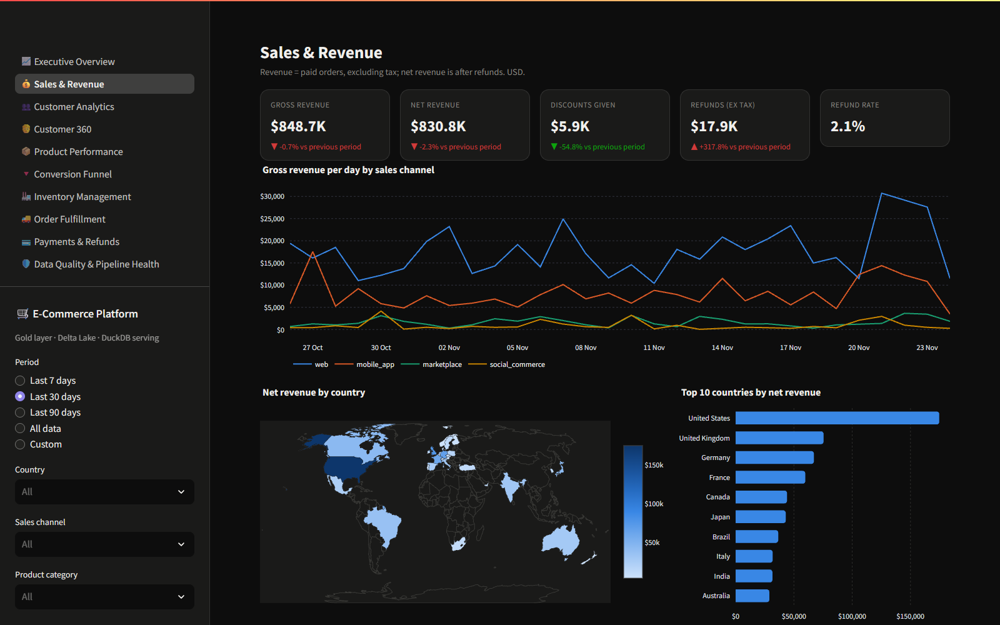
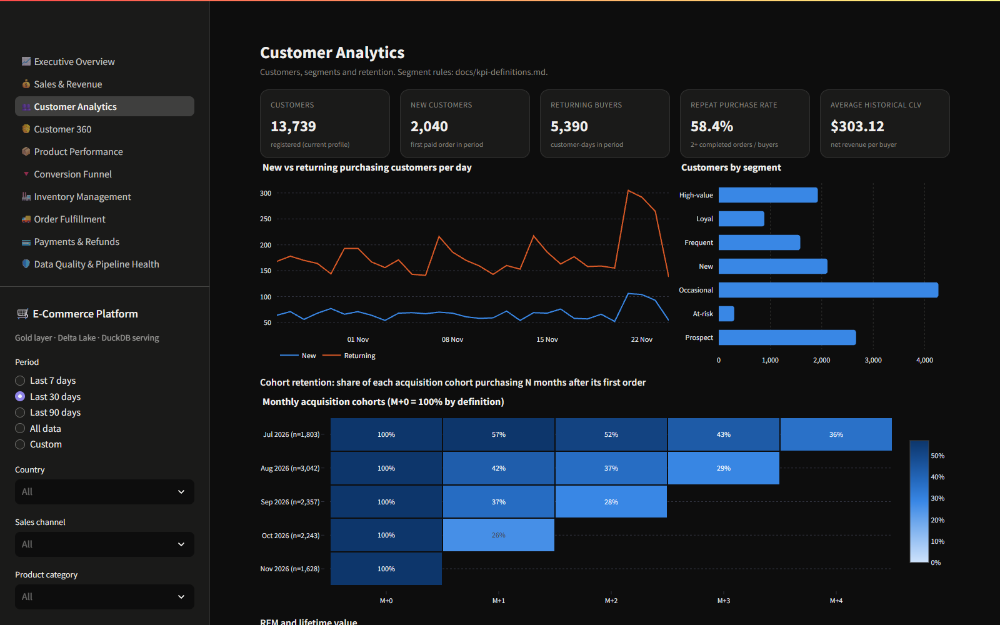
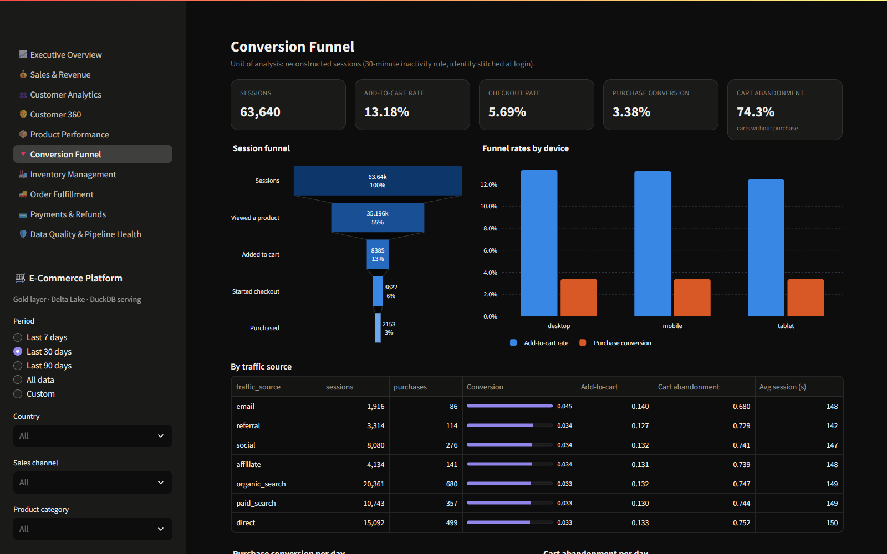
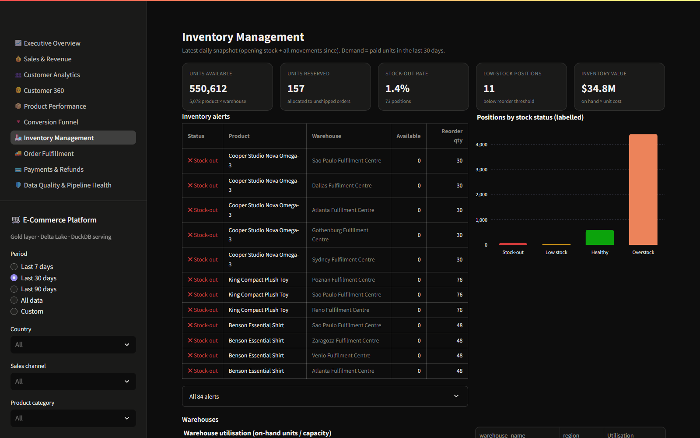
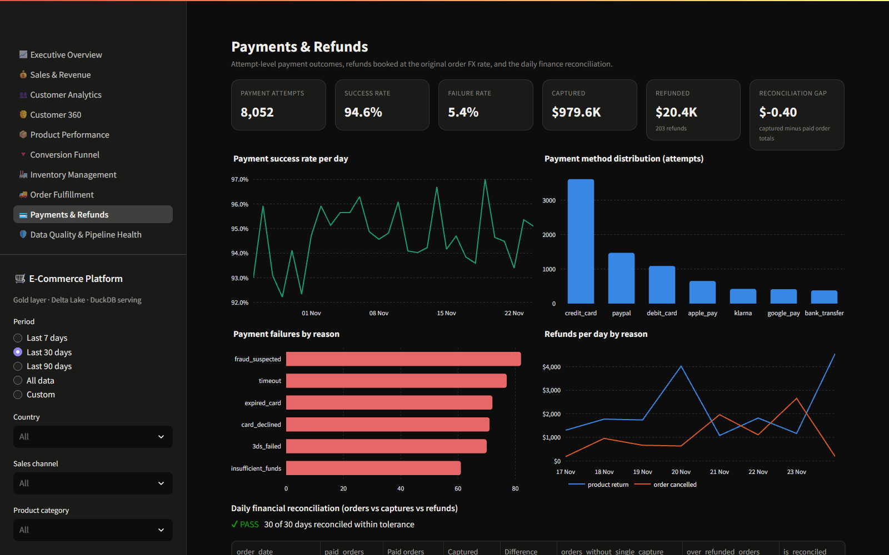
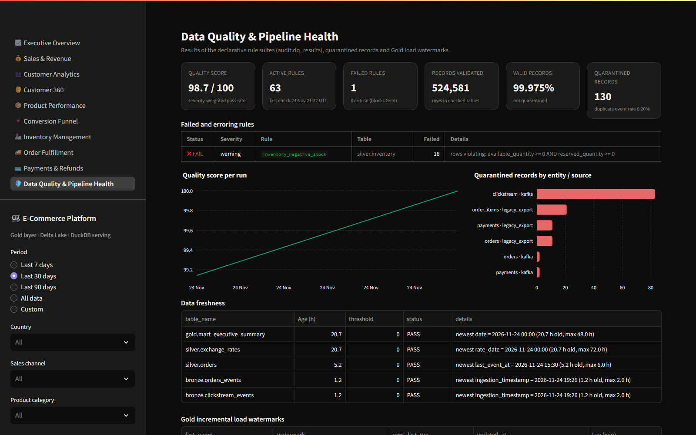
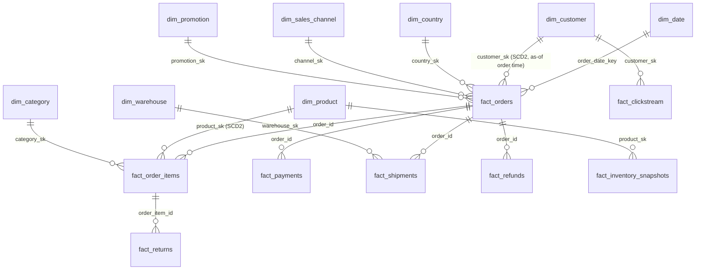

# Real-Time E-Commerce Data Platform

[](.github/workflows/ci.yml)
 
 
 

A production-style, end-to-end data platform for an international e-commerce company. Simulated customer
journeys stream through **Kafka** (Avro contracts, Schema Registry). **PySpark Structured Streaming** lands them in a
**Delta Lake** lakehouse on S3-compatible storage. Batch sources (PostgreSQL, partner files, REST APIs) are
ingested with watermarks and checksums. Data is refined through **Bronze → Silver → Gold** into a Kimball star
schema with 13 KPI marts. Workloads are orchestrated by **Airflow**, guarded by a declarative **data-quality**
framework, monitored with **Prometheus + Grafana**, and served to a **Streamlit** dashboard and **Power BI**. The
whole stack runs locally with one command. An optional **AWS (Terraform) + Databricks** deployment uses the same code.



> Everything shown in this README was produced by running the code in this repository: screenshots are of the
> running dashboard on generated data, and benchmark numbers are measurements (see [benchmarks/](benchmarks/README.md)).

---

## Contents
[Business problem](#business-problem) · [Architecture](#architecture) · [Dashboards](#dashboards) · [Tech stack](#technology-stack) ·
[Data model](#data-model) · [Key engineering features](#key-engineering-features) · [Quick start](#quick-start) ·
[Testing](#testing) · [Benchmarks](#benchmarks) · [Data quality](#data-quality) ·
[Failure recovery](#reliability-and-failure-recovery) · [Security](#security) · [Cloud deployment](#cloud-deployment-optional) ·
[Costs](#cost-considerations) · [Limitations](#known-limitations) · [Roadmap](#future-improvements) · [Repository](#repository-structure)

## Business problem

The company sells about 10,000 products in 30 countries (21 currencies) through web, mobile app, marketplace and
social-commerce channels. Behavioural, order, payment, warehouse and partner data are siloed. Reporting is slow,
KPIs are inconsistent between teams, and nobody can see what is happening *now*.

**Objectives** ([full requirements](docs/business-requirements.md))
1. One governed definition of every KPI: GMV, gross and net revenue, AOV, conversion, retention, CLV, stock-outs,
   on-time delivery and payment success ([KPI catalogue](docs/kpi-definitions.md)).
2. Operational visibility within minutes, and complete, reconciled numbers daily.
3. Customer 360 with RFM segmentation, CLV and cohort retention.
4. Trustworthy data: automated checks; broken data never reaches business tables.
5. A design target of **10M events/day**, measured rather than assumed. Free to run locally; cloud is optional.

## Architecture



Detailed diagrams: [system architecture](architecture/system-architecture.md) · [data flow](architecture/data-flow.md)
(late and out-of-order data, delivery semantics) · [deployment](architecture/deployment-architecture.md) ·
[dimensional model](architecture/data-model.md) · [failure recovery](architecture/failure-recovery.md) ·
11 [architecture decision records](docs/adr/README.md).

### Medallion layers

| Layer | Contents | Write pattern |
|---|---|---|
| **Bronze** | 9 Kafka event tables (envelope + raw Avro bytes + JSON payload + Kafka coordinates) and 16 batch tables (source columns + checksum, file and batch metadata) | Append; per-micro-batch Delta transaction ids (exactly-once per offset) |
| **Silver** | 23 tables: customers (+ SCD2 history), products, orders, items, payments, shipments, inventory movements and position, clickstream, sessions, refunds, returns, FX, reference data | MERGE; order-independent lifecycle folding; row-level validation → quarantine |
| **Gold** | 10 dimensions, 8 facts, 13 marts, financial reconciliation, real-time per-minute aggregates | Incremental MERGE via watermarks; SCD1/SCD2; marts recomputed |

## Dashboards

Ten Streamlit pages query Gold live through the DuckDB serving layer, with no hard-coded numbers. They share
global date, country, channel and category filters and offer CSV export, an auto-refresh toggle, and loading,
empty and error states. The colour system is a CVD-validated categorical palette. Status colours are always paired
with an icon and label.

| | |
|---|---|
|  |  |
| **Sales & Revenue**: channel trends, revenue map, categories, discount and refund impact | **Customer Analytics**: new vs returning, segments, cohort retention, RFM, CLV |
|  |  |
| **Conversion Funnel**: session funnel, device and source breakdowns, abandonment | **Inventory Management**: alerts, stock status, utilisation, turnover |
|  |  |
| **Payments & Refunds**: success rate, methods, failure reasons, reconciliation | **Data Quality & Pipeline Health**: score, failed rules, quarantine, freshness, watermarks |

Also: Customer 360 ([screenshot](dashboards/screenshots/04_customer_360.png)), Product Performance
([screenshot](dashboards/screenshots/05_product_performance.png)), Order Fulfillment
([screenshot](dashboards/screenshots/08_order_fulfillment.png)). Grafana: [Kafka health](dashboards/screenshots/grafana_kafka_health.png),
[data quality](dashboards/screenshots/grafana_data_quality.png).

**Power BI:** [connection guide, semantic model and DAX measures](dashboards/powerbi/README.md). No `.pbix` is
committed: a binary report cannot be reviewed, and building one requires Power BI Desktop.

## Technology stack

| Concern | Technology |
|---|---|
| Event streaming | Apache Kafka 3.8 (Confluent Platform 7.8, KRaft), Schema Registry (Avro, BACKWARD), Kafka Connect / Debezium (optional CDC profile) |
| Processing | Apache Spark 3.5.4 / PySpark Structured Streaming, Delta Lake 3.3 |
| Storage | S3-compatible object storage: SeaweedFS locally ([ADR 0011](docs/adr/0011-object-storage-seaweedfs.md): MinIO community builds were withdrawn), AWS S3 in the cloud |
| Operational DB / control plane | PostgreSQL 16 (`ops` source schema, `meta` watermarks and file registry, `analytics` BI serving) |
| Orchestration | Apache Airflow 2.10.5 (LocalExecutor, data-aware scheduling) |
| Serving and BI | DuckDB + delta-rs, Streamlit + Plotly, Power BI (semantic model + DAX) |
| Quality | Declarative YAML rules engine (pydantic + PySpark), `audit.dq_results`, promotion gate |
| Observability | Prometheus, Pushgateway, kafka-exporter, statsd-exporter, cAdvisor, Grafana |
| Cloud (optional) | Terraform (S3, KMS, IAM, CloudWatch, budgets, Unity Catalog), Databricks Asset Bundle |
| Quality tooling | pytest (+ coverage), Ruff, mypy, sqlfluff, pip-audit, Gitleaks, GitHub Actions |

All versions are pinned and aligned with the official Airflow 2.10.5 / Python 3.11 constraints
([requirements.txt](requirements.txt)).

## Data model



Each fact table has a documented grain. The model uses hashed, deterministic surrogate keys; unknown (-1) and
inferred members for late-arriving dimensions; SCD2 on customer segment, loyalty and country and on product
price, status and category; and USD plus local-currency measures. Double counting across the
order / line / payment / refund grains is prevented by pre-aggregating to order grain, and a
test with 3 lines, 2 payment attempts and 2 partial refunds proves it. Full details: [architecture/data-model.md](architecture/data-model.md),
generated [data dictionary](docs/data-dictionary.md) (87 tables).

### Business workflows simulated

```mermaid
flowchart LR
    V[Visit] --> PV[Browse / search /<br/>product views]
    PV --> C[Add / remove<br/>cart]
    C -->|abandon| X1((lost))
    C --> CO[Checkout]
    CO -->|guest must register| R[Registration]
    CO --> O[Order + lines]
    O --> RES[Inventory<br/>reservation]
    RES --> P{Payment}
    P -->|fail + retry fail| CX[Cancel + release stock]
    P -->|captured| CF[Confirmed]
    CF -->|customer cancels| RF1[Refund]
    CF --> SH[Shipment(s) per warehouse] --> DL[Delivered / delayed]
    DL --> RT[Return] --> RF2[Refund + restock]
    RES -.->|below threshold| REP[Supplier replenishment]
```

The simulator ([data_generator/](data_generator/)) is deterministic per seed and stateful: stock levels, loyalty
tiers and replenishments evolve. It models weekend uplift, seasonal promotions, a Black Friday spike (≈4.5×),
country time zones, returning customers, abandoned carts, payment failures (by method, basket size and peak load),
stock-outs, multi-warehouse shipments, carrier delays and category-specific return rates. Defects are injected on
purpose (duplicates, late and out-of-order events, invalid payloads) to exercise the quality and recovery paths.

## Key engineering features

* **Contract-first streaming:** one envelope for every event; Avro schemas generated from a single Python
  definition (`schemas/contracts.py`); producers validate before sending, never auto-register, and route
  violations to a dead-letter topic; Bronze decodes with the *writer* schema id for safe schema evolution.
* **Effectively-once Bronze:** checkpointed offsets plus Delta `txnAppId`/`txnVersion`. A crash between write and
  commit is replayed without duplicates (an integration test simulates exactly this).
* **Order-independent Silver:** lifecycle events are folded with commutative operations (rank max, timestamp min),
  so late, duplicated or out-of-order events converge to the same row. Lateness is measured against the stream
  position, not the wall clock, so replays aren't mislabelled as late.
* **Incremental everything:** Silver runs as Delta streams triggered `availableNow` by Airflow (or continuously).
  Gold facts use watermarks and reprocess an order when any of its payments, refunds or shipments change.
* **Finance-grade numbers:** daily FX with forward-fill; refunds booked at the original order rate; daily
  reconciliation of orders vs captures vs refunds that fails the DAG outside tolerance.
* **Governed quality:** 63 declarative rules (unique, not-null, ranges, referential, freshness, row-count anomaly,
  custom SQL reconciliations, status transitions, duplicate rate), each with a severity; critical failures block Gold.
* **Operability:** structured JSON logs with correlation ids, Prometheus metrics from every job, 6 Grafana dashboards,
  20 alert rules linked to a [runbook](docs/operational-runbook.md), and replay / requeue / dead-letter tools.

## Quick start

**Requirements:** Docker Desktop (≥ 8 GB RAM for the core stack, 12–16 GB for everything), 20 GB disk,
and `make` (Linux / macOS / WSL) or PowerShell (`./make.ps1` on Windows).

```bash
git clone https://github.com/OWNER/real-time-ecommerce-data-platform.git
cd real-time-ecommerce-data-platform
make demo          # Windows: ./make.ps1 demo
```

`make demo` builds the image, starts Kafka, Schema Registry, PostgreSQL, object storage and the reference API,
then:
1. seeds master data plus 120 days of legacy order history;
2. publishes 7 days of live events to Kafka;
3. streams them to Bronze;
4. ingests all batch sources;
5. runs Silver, Gold, data quality and reconciliation;
6. publishes to Power BI serving and starts the dashboard.

| UI | URL |
|---|---|
| Streamlit dashboard | http://localhost:8501 |
| Grafana (`make up`) | http://localhost:3001 |
| Airflow (`make airflow`) | http://localhost:8088 |
| Prometheus | http://localhost:9090 |
| Schema Registry | http://localhost:8081/subjects |
| Object storage (S3 API) | http://localhost:9000 |

Host ports are configurable in `.env` (PostgreSQL uses **5433** to avoid clashing with a local PostgreSQL).

### Common commands

| Command | What it does |
|---|---|
| `make up` / `make up-all` | Core services + dashboard + monitoring / everything incl. continuous streaming and Airflow |
| `make seed` (`SCALE=full`) | Master data (lite: 5k customers / 1k products; full: 100k / 10k) and history |
| `make stream` / `make stream-service` | Bounded catch-up into Bronze / continuous producer + Bronze stream |
| `make batch` · `make transform` | Batch ingestion · Silver + Gold + quality + reconciliation |
| `make test` · `make lint` | Unit + Spark tests with coverage · Ruff, mypy, sqlfluff |
| `make test-integration` · `make test-e2e` | Against the running services |
| `make benchmark EVENTS=1000000` | Measured load test (isolated topics and lakehouse root) |
| `make status` | Row counts of every lakehouse table |
| `make reset` | Remove all containers **and data volumes** (asks for confirmation) |

**Execution modes:** `PLATFORM_SCALE=lite` (default, laptop-friendly) or `full` (specification reference scale).
The live producer speed is set by `GENERATOR_EVENTS_PER_SECOND`.

## Testing

| Suite | What it proves | Where it runs |
|---|---|---|
| Unit (pure Python) | Simulator consistency (referential integrity, money identities, lifecycle, inventory deltas, determinism), contracts, validation, rate limiting, config | anywhere |
| Unit (Spark) | Dedup, out-of-order folding, idempotent MERGE, stream-relative lateness, validation reasons, FX fill, PII masking, sessionisation, **no double counting**, SCD2 versioning | platform container, CI |
| Data quality | Every check type, scoring, the promotion gate | platform container, CI |
| Integration | Avro round trip via Schema Registry, DLQ routing, incompatible schema rejection, watermarks + file registry, object storage, REST API, corrupt / malformed / duplicate files, **streaming crash recovery without duplicates** | live services |
| End-to-end | An order published to Kafka flows Bronze → Silver → Gold; a duplicate capture event is counted once; metrics match a hand calculation | live services |
| DAG validation | 14 DAGs import; retries, back-off, timeouts, callbacks, pools; no streaming in Airflow | Airflow image / CI |

Latest local run: **46 unit/DQ tests and 9 integration/e2e tests passing**. Unit coverage is 51%: the I/O-heavy
modules (streaming, ingestion, serving) are exercised by the integration and e2e suites instead.

## Benchmarks

Measured on one workstation (i7-10700, 16 vCPU / 15.5 GB Docker VM) with every service co-located
([full report, method and analysis](benchmarks/README.md)):

| Metric (1M-event run) | Result |
|---|---|
| Event generation | 42k–53k events/s |
| Producer (Avro, Schema Registry, idempotent, `acks=all`) | **6,655 events/s**; steady-rate ack p50 22 ms |
| Kafka → Bronze Delta (4 Spark cores, availableNow drain) | **4,943 rows/s** (1M rows in 202 s incl. start-up) |
| End-to-end latency at 500 events/s (10 s trigger) | p50 **18.8 s** · p95 43.8 s · p99 47.9 s |
| Gold serving queries (DuckDB over Delta) | **20–26 ms** median |
| Storage | ≈ 0.27 KB/event on the wire, ≈ 0.30 KB/event in Bronze |

The 10M events/day design target averages 116 events/s, with a peak of about 1,200. The measured ingestion rate gives
≈ 40× and ≈ 4× headroom respectively. **A 10M-event run was not executed.** The report covers bottlenecks
(per-batch commit overhead drives latency; 12 partitions per topic on one broker cut producer throughput fivefold)
and recommendations.

## Data quality

* Rules: [`data_quality/rules/{bronze,silver,gold}.yaml`](data_quality/rules), 63 checks with owners and severities.
* **Critical** failures raise `DataQualityGateError` before any Gold write. The previous Gold state keeps serving.
* **Row level:** invalid records go to `quarantine.silver_rejects` with machine-readable reasons, so nothing is silently dropped.
* Results are kept in `audit.dq_results` (trend, score) and pushed to Prometheus; a Markdown report is written per run.
* Current state on the demo data: all critical checks pass; quality score 98.7. The one failing **warning**
  (`inventory_negative_stock`, 18 positions) is a real finding: some inventory movements were among the
  contract-violating events routed to the dead-letter topic, so delta-based stock positions drift below zero. This
  is exactly what the check exists to catch.
* Contracts, ownership, lineage and retention: [data contracts](docs/data-contracts.md), [security](docs/security.md#data-retention).

## Reliability and failure recovery

The platform provides **at-least-once delivery with idempotent, deduplicating processing**. It does *not* claim
end-to-end exactly-once ([ADR 0010](docs/adr/0010-reliability-tradeoffs.md)). Bronze ingestion is effectively-once
per Kafka offset; business tables see each `event_id` exactly once.

All 16 failure scenarios are listed in [architecture/failure-recovery.md](architecture/failure-recovery.md), each
with its detection, automatic behaviour, manual recovery and the test that verifies it. Infrastructure faults that
aren't practical to reproduce in CI (broker loss, storage outage) are marked as drills.
Tools: `scripts/replay_bronze.py`, `scripts/replay_dead_letter.py`, `scripts/requeue_quarantined_files.py`, the
`historical_backfill` DAG, and Delta time travel / `RESTORE` ([DR guide](docs/disaster-recovery.md)).

## Security

Secrets come only from the environment or a secret manager (`.env` is git-ignored; CI runs Gitleaks). PII is pseudonymised in
Silver (salted SHA-256, masked e-mail, initial only), and Gold / BI never see raw PII. In the cloud: SSE-KMS, TLS-only bucket
policies, least-privilege IAM (Unity Catalog role with external id, write-only ingestion, Gold-only BI reader)
and Unity Catalog grants. Local credentials are clearly separated from production requirements. All data is
synthetic. [docs/security.md](docs/security.md)

## Cloud deployment (optional)

* **Terraform** ([infrastructure/terraform](infrastructure/terraform/README.md)): KMS, S3 (landing, lakehouse, logs;
  lifecycle policies), IAM, CloudWatch + SNS + budget, and an optional Unity Catalog module; `dev` and `prod` environments.
* **Databricks** ([infrastructure/databricks](infrastructure/databricks/README.md)): an Asset Bundle with a continuous
  Bronze job, a medallion batch job (Silver → DQ gate → Gold → reconciliation) and a maintenance job. All jobs are
  deployed paused and run the same modules as locally.
* Nothing is provisioned automatically, and CI only formats and validates.

## Cost considerations

The local stack is free. A production deployment at the 10M events/day target is estimated at
**≈ 1,000–2,500 USD/month** (Kafka and Databricks compute dominate). Levers, assumptions and cleanup are in
[docs/cost-analysis.md](docs/cost-analysis.md).

## Known limitations

* **Single-node local stack.** One Kafka broker (RF=1) and single-node object storage; the cloud design is where HA lives.
* **SeaweedFS + S3A directory semantics.** Local streaming checkpoints use a Docker volume instead of S3, and
  Delta's periodic log checkpoint write logs a warning. Commits are unaffected (ADR 0011).
* **Single writer per Delta table** with the OSS S3 log store. Airflow serialises Spark jobs through a 2-slot pool.
* **Legacy history** contains orders, items and payments only; shipments, returns and clickstream start at go-live.
* **Inventory positions** are opening stock plus event deltas, so movements lost to the dead-letter path cause drift
  (flagged by DQ; a periodic cycle-count reload is the remedy).
* **Real-time aggregates** drop events beyond the 10-minute watermark (by design; Gold is complete).
* **Not run locally because of memory limits:** the Airflow containers. DAG validation runs in CI, and every DAG
  task is a CLI command that was executed directly during development.
* The Databricks bundle and Terraform were validated statically, not applied: no paid resources were created.
* The Debezium CDC connector (`cdc` profile, `ingestion/kafka_connect/`) is configured but not part of the automated
  test suite; the default PostgreSQL path is the tested watermark-based extract.

## Future improvements

Debezium CDC as the default customer and product feed; Unity Catalog lineage and tags; dbt for the marts layer;
predictive CLV and demand forecasting; Great Expectations / Soda adapters for the rule engine; multi-broker Kafka
with rack awareness; OpenLineage events from Airflow; Trivy image scanning; Airflow 3 migration (Assets,
deadline alerts).

## Repository structure

```
├── architecture/        system, data-flow, deployment, data-model, failure-recovery (Mermaid)
├── benchmarks/          load-test runner + measured results
├── config/              local.yaml, cloud.yaml, kafka-topics.yaml, batch_sources.yaml
├── dashboards/          streamlit/ (10 pages), powerbi/ (guide, model, DAX), screenshots/
├── data_generator/      deterministic journey simulator (customers, products, orders, payments, inventory, ...)
├── data_models/marts/   13 Spark SQL marts (KPI logic)
├── data_quality/        rules/ (YAML), validators/ (engine), gate, reports/
├── docker/              platform + Airflow images, init scripts
├── docs/                requirements, KPIs, contracts, dictionary, runbook, DR, security, costs, ADRs
├── infrastructure/      terraform/ (modules + dev/prod), databricks/ (asset bundle + jobs)
├── ingestion/           kafka_producers/ (admin, producer, run), batch/ (extract, loader, registry, REST API)
├── monitoring/          prometheus/ (scrape, 20 alerts), grafana/ (6 dashboards as code)
├── orchestration/dags/  14 Airflow DAGs
├── pipelines/           common/, bronze/, silver/, gold/, maintenance
├── schemas/             contracts.py → avro/ + json/
├── scripts/             replay, requeue, DLQ replay, status, docs and screenshot generators
├── serving/             DuckDB-over-Delta SQL serving layer
├── sql/ddl/             PostgreSQL ops / meta / analytics schemas
└── tests/               unit/, data_quality/, integration/, end_to_end/
```

## License
MIT. All data is synthetic.
