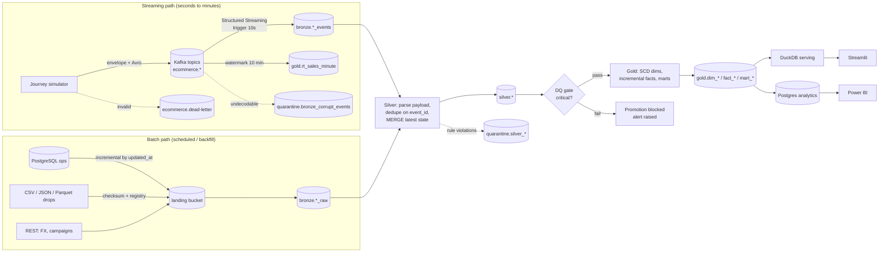

# Data Flow

## End-to-end flow

## Event envelope

Every Kafka message uses the same envelope (Avro record `EventEnvelope`, one
subject per topic: `<topic>-value`):

| Field | Type | Notes |
|---|---|---|
| `event_id` | string (UUID v5, deterministic per seed) | Global dedup key |
| `event_type` | string | e.g. `order_created`; allowed values per topic in `config/kafka-topics.yaml` |
| `event_version` | int | Payload contract version |
| `event_timestamp` | timestamp-millis (UTC) | Business event time |
| `source_system` | string | `ecommerce-platform`, `payment-gateway`, `wms`, ... |
| `correlation_id` | string | Ties all events of one customer journey / order together |
| `payload` | entity-specific record | See `schemas/avro/*.avsc` |

## Layer contracts

| Layer | Grain | Write mode | Schema policy | Retention |
|---|---|---|---|---|
| Bronze `*_events` | One row per Kafka record | Append (idempotent per micro-batch) | Fixed envelope columns + `raw_payload` JSON string, so payload changes never break ingestion | 90 days hot, then lifecycle to archive |
| Bronze `*_raw` | One row per source record per load | Append | Source columns + ingestion metadata; `mergeSchema` allowed (schema evolution) | 90 days |
| Silver | One row per business entity (latest state) or per event (clickstream, payments) | MERGE (upsert / insert-if-absent) | Enforced; additive evolution only via code change | 2 years |
| Gold | Documented per table in [data-model.md](data-model.md) | MERGE / partition overwrite | Enforced | 5 years (finance) |
| Audit | One row per check / run / file | Append | Enforced | 1 year |

## Late and out-of-order events

Kafka keys give per-entity ordering inside a partition. Events can still arrive
out of order (mobile clients that were offline, retries, producer replays).
Treatment per path:

| Path | Mechanism | Event older than the watermark |
|---|---|---|
| Bronze | Append everything; no watermark | Always stored |
| Silver entities (orders, payments, shipments...) | `MERGE` keyed on business id. A status only moves *forward* in the lifecycle rank (`created < confirmed < shipped < delivered < returned`; `cancelled` is terminal before shipment). Timestamps per status are kept separately, so a late `order_confirmed` arriving after `order_shipped` fills `confirmed_at` without regressing the status. | Incorporated; flagged `is_late_arrival = true` when `ingestion_ts - event_ts > 60 min` |
| Silver clickstream / sessions | Event dedupe on `event_id`; sessions touched by new events are recomputed and MERGEd | Incorporated into the session |
| Real-time aggregate `gold.rt_sales_minute` | `withWatermark(event_ts, '10 minutes')` + 1-minute tumbling windows, append mode | **Dropped from the real-time view only.** They are counted by Spark's `numRowsDroppedByWatermark` metric (exported to Prometheus), and the daily Gold rebuild from Silver includes them. |
| Gold facts | Incremental MERGE on fact natural key, driven by Silver change data (`_silver_updated_at`) | Corrected on next run |

The **operational (real-time) view is eventually consistent**. The **daily
reporting view is complete**. Both are labelled as such in the dashboard.

## Delivery semantics (actual, end to end)

| Hop | Guarantee | How |
|---|---|---|
| Simulator → Kafka | At-least-once, no duplicates from producer retries | `enable.idempotence=true`, `acks=all`. Application-level replays can still duplicate, by design for testing. |
| Kafka → Bronze | Effectively once per Kafka offset | Checkpointed offsets + Delta `txnAppId`/`txnVersion` make a replayed micro-batch a no-op |
| Bronze → Silver | Effectively once per `event_id` | `MERGE ... WHEN NOT MATCHED INSERT` on `event_id` / business keys |
| Silver → Gold | Idempotent recomputation | MERGE on keys, partition overwrite for snapshots |
| Producer duplicates (same `event_id` sent twice) | Removed in Silver | Bronze keeps both copies for audit |

The platform therefore **does not claim exactly-once delivery** for the whole
path. It provides **at-least-once delivery with idempotent, deduplicating
processing**, so every `event_id` affects business tables exactly once.
`tests/end_to_end` and `tests/integration/test_streaming_recovery.py` verify this.
