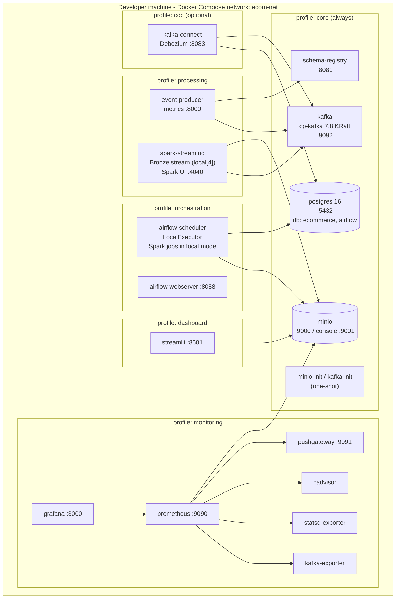
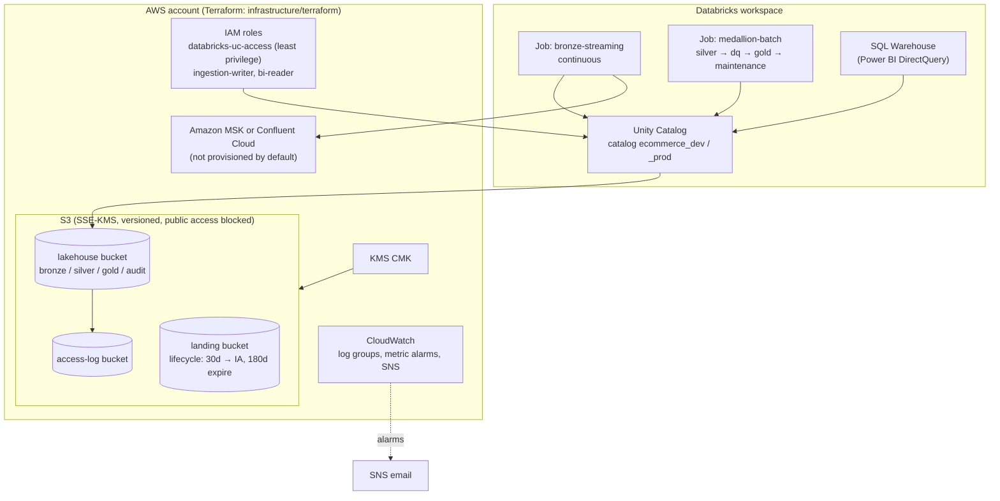

# Deployment Architecture

Two deployment targets share one codebase.

## 1. Local development (Docker Compose)

| Profile | Services | Purpose |
|---|---|---|
| `core` | kafka, schema-registry, postgres, minio, init jobs | Minimum to run producers and Spark jobs |
| `processing` | spark-streaming, event-producer | Continuous streaming path |
| `orchestration` | airflow-init, airflow-webserver, airflow-scheduler | Scheduled batch, backfills, maintenance |
| `dashboard` | streamlit | Business UI |
| `monitoring` | prometheus, pushgateway, kafka-exporter, statsd-exporter, cadvisor, grafana | Observability |
| `cdc` | kafka-connect (Debezium) | Optional CDC from PostgreSQL |

Spark runs in **local mode inside containers** (one JVM per job). On a single
machine this is the most resource-efficient option. A standalone cluster adds
scheduling overhead without adding parallelism. The `SPARK_MASTER` variable
switches jobs to any cluster URL.

## 2. Optional cloud deployment (AWS + Databricks)

* Nothing is provisioned automatically. `terraform plan` is safe to run.
  `apply` is a manual, documented step ([docs/cost-analysis.md](../docs/cost-analysis.md)).
* Databricks jobs are defined as a Databricks Asset Bundle
  (`infrastructure/databricks/databricks.yml`). They call the same modules as
  local runs, so no notebook-only logic exists.
* `dev` and `prod` differ in bucket names, retention, KMS deletion window,
  alarm thresholds and cluster sizes (`infrastructure/terraform/environments/*`).
