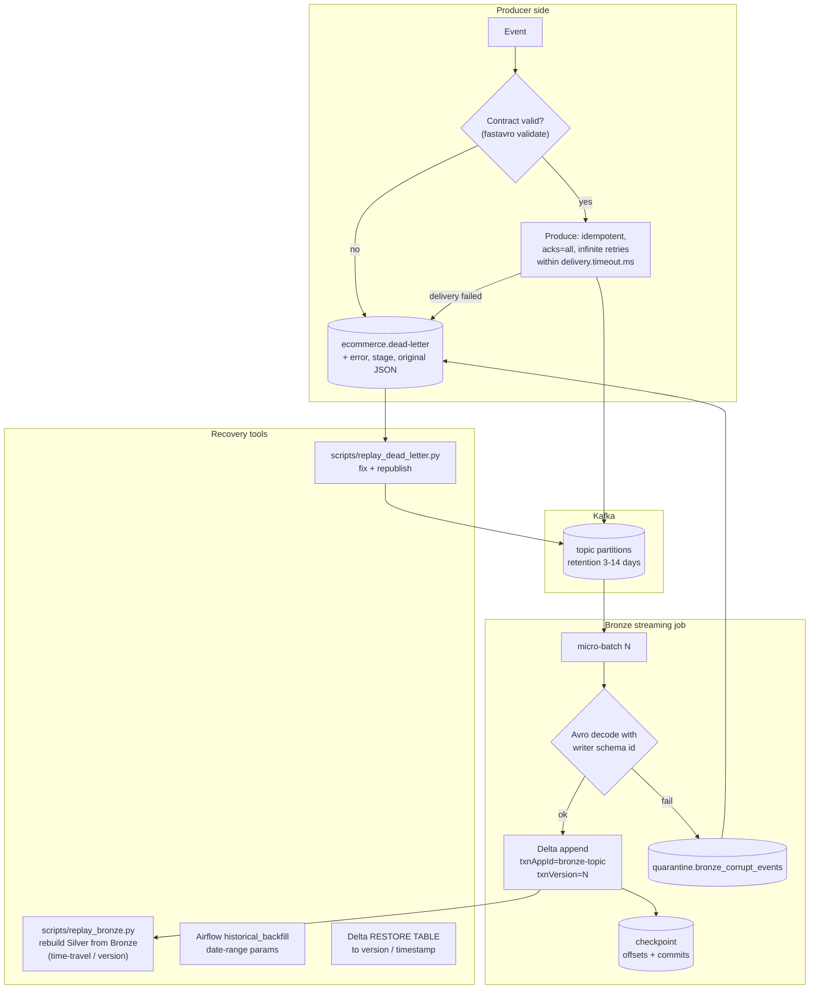

# Failure Recovery Architecture

## Scenario matrix

"Verified by" names the automated test that exercises the scenario. Scenarios marked *drill* depend on
infrastructure faults that are impractical in CI; they are covered by the runbook and by the mechanisms listed.

| Failure | Detection | Automatic behaviour | Manual recovery | Verified by |
|---|---|---|---|---|
| Duplicate Kafka messages (producer replay) | `bronze_*_duplicate_event_rate` DQ check | Bronze stores both; Silver dedups on `event_id`, entity folds are idempotent | none | `tests/unit/test_silver_transformations.py::test_fold_orders_is_order_independent_and_deduplicates`, `tests/end_to_end` (duplicate capture event counted once) |
| Kafka broker interruption | kafka-exporter `kafka_brokers`, producer delivery errors | Producer retries until `delivery.timeout.ms`; then DLQ. Stream fails and resumes from its checkpoint after restart | Restart broker | *drill* ([runbook](../docs/operational-runbook.md#kafka-broker-down)) |
| Spark streaming job crash | `StreamingQueryStalled` alert | Container restart; resume from checkpoint | none | `tests/integration/test_streaming_recovery.py` |
| Consumer restart after write, before commit | – | Replayed micro-batch skipped by Delta `txnAppId`/`txnVersion` | none | `tests/integration/test_streaming_recovery.py` (commit log entry deleted → zero duplicate rows) |
| Invalid event schema | Producer validation, Bronze decode errors | Routed to `ecommerce.dead-letter` with error + original event | Fix producer, republish | `tests/unit/test_producer_validation.py`, `tests/integration/test_services.py::test_invalid_event_goes_to_dead_letter` |
| Corrupted source file | Loader parse failure | File moved to `quarantine/` prefix, registry `FAILED`; other files continue | Fix file, `scripts/requeue_quarantined_files.py` | `tests/integration/test_batch_ingestion.py` |
| Malformed rows inside a file | `_corrupt_record` | Rows to `quarantine.batch_corrupt_records`, valid rows loaded | none | `tests/integration/test_batch_ingestion.py` |
| Duplicate file delivery | Checksum match in `meta.file_registry` | Marked `DUPLICATE`, not loaded | none | `tests/integration/test_batch_ingestion.py`, `test_services.py::test_watermark_two_phase_commit_and_file_registry` |
| Missing reference data | `orders_customer_exists` (warning) | Facts point to unknown (-1) or inferred dimension members | Load reference data; next run repairs | `tests/unit/test_gold_marts.py` (unknown member), `dim_customer` inferred members |
| Late-arriving events | `is_late_arrival` flag, watermark drop metric | Silver MERGE incorporates; real-time view drops beyond watermark | none | `tests/unit/test_silver_transformations.py::test_late_arrival_is_relative_to_stream_position` |
| Out-of-order events | – | Status rank never regresses; timestamps fill in | none | `tests/unit/test_silver_transformations.py::test_merge_is_idempotent_and_never_regresses_status` |
| Object storage interruption | `ObjectStorageDown`, S3 5xx alarm | Task retries; Delta never exposes partial commits | Rerun failed task | *drill* (atomic Delta commits; [runbook](../docs/operational-runbook.md#object-storage-unavailable)) |
| Partial batch failure | Airflow failure callback | Per-source / per-file isolation; watermark advances only after commit; retries with back-off | Clear task | `tests/integration/test_batch_ingestion.py`, DAG settings in `tests/integration/test_airflow_dags.py` |
| Historical replay | – | – | `scripts/replay_bronze.py`, `historical_backfill` DAG | Executed on real data: replay reproduced identical Silver row counts (IMPLEMENTATION_PLAN.md, Phase 6) |
| Schema evolution | Schema Registry compatibility check | BACKWARD-compatible changes accepted; Bronze decodes with writer→reader resolution | Incompatible change rejected | `tests/integration/test_services.py::test_schema_registry_rejects_incompatible_change` |
| Bad source file schema (all-null column) | Loader `align_null_columns` | Column re-typed to the Bronze type | – | Found and fixed on real data (Phase 5 log) |
