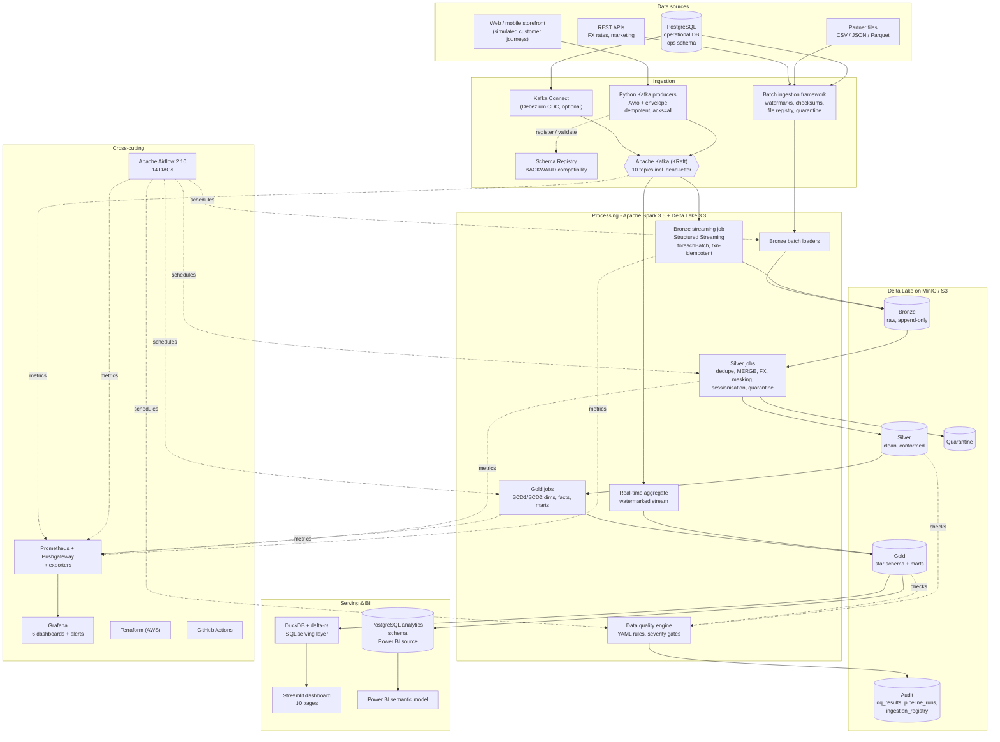

# System Architecture

## Context

An international e-commerce company (30 countries, 4 sales channels, multiple
currencies) needs one platform that serves **near-real-time operational
analytics** (minutes) and **trusted historical reporting** (daily). The
platform is built as a **lakehouse** with the medallion pattern on Delta Lake.
It runs fully on a laptop (Docker Compose + MinIO). An optional AWS + Databricks
deployment uses the same code.

## Logical architecture

## Component responsibilities

| Component | Responsibility | Runs as |
|---|---|---|
| Event simulator (`data_generator/`) | Generates relationally consistent customer journeys (browse → cart → checkout → payment → fulfilment → returns). The output is deterministic for a given seed. | CLI / `event-producer` container |
| Kafka producers (`ingestion/kafka_producers/`) | Wrap each event in the standard envelope, validate it against the Avro contract, serialise via Schema Registry, publish with `acks=all` and idempotence on, route invalid events to `ecommerce.dead-letter` | Long-running container |
| Batch ingestion (`ingestion/batch/`) | Full or incremental loads from PostgreSQL, files and REST APIs into the landing bucket and Bronze. Tracks watermarks, checksums and a file registry. | Airflow tasks |
| Bronze streaming (`pipelines/bronze/stream_kafka_to_bronze.py`) | Reads all event topics, decodes Confluent Avro using the writer schema from the registry, appends to per-topic Bronze tables with idempotent Delta transactions, and quarantines corrupt records | Long-running `spark-streaming` container (or Databricks job) |
| Silver (`pipelines/silver/`) | Incremental processing (Delta streaming, `availableNow`) with deduplication, MERGE upserts, UTC/FX normalisation, PII masking, referential checks, quarantine and sessionisation | Airflow (bounded `availableNow` runs) or continuous |
| Gold (`pipelines/gold/`, `data_models/`) | Star schema with SCD1 and SCD2 dimensions, incremental facts, KPI marts and Customer 360 | Airflow |
| Data quality (`data_quality/`) | Declarative rules, severity-based gates, results in `audit.dq_results` | Airflow + inline in pipelines |
| Serving (`serving/`) | DuckDB views over Gold Delta tables (delta-rs, no JVM). Marts are also exported to PostgreSQL for Power BI. | Library used by Streamlit |
| Observability (`monitoring/`) | Prometheus scraping (kafka-exporter, MinIO, cAdvisor, statsd-exporter for Airflow) and a Pushgateway for batch job metrics. Grafana dashboards and alert rules. | Containers |

## Key design principles

1. **Raw is immutable.** Bronze keeps the full original payload (`raw_payload`)
   and Kafka coordinates, so any downstream table can be rebuilt by replay.
2. **Idempotency everywhere.** Bronze stream writes use Delta `txnAppId/txnVersion`.
   Silver and Gold use `MERGE` on natural keys. Batch loads are keyed by file
   checksum or watermark. Re-running any job produces the same result.
3. **Correctness over latency for reporting.** The real-time aggregate uses
   event-time watermarks and may drop very late events. The Silver/Gold batch
   path is MERGE-based and always incorporates late data. See
   [data-flow.md](data-flow.md#late-and-out-of-order-events).
4. **Gates, not hopes.** Critical data-quality failures stop promotion to Gold.
5. **Same code, two runtimes.** `pipelines/common/spark.py` detects Databricks
   and switches from path-based tables to Unity Catalog names.

See also: [data-flow.md](data-flow.md), [deployment-architecture.md](deployment-architecture.md),
[data-model.md](data-model.md), [failure-recovery.md](failure-recovery.md) and the ADRs in
[`docs/adr/`](../docs/adr).
